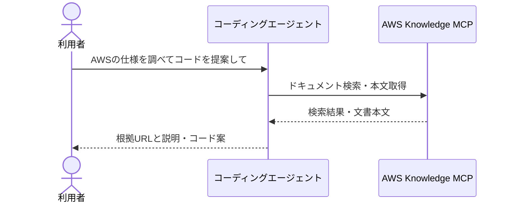

# 既存のMCPをコーディングエージェントで使う

AWS Knowledge MCP ServerをCodex、Claude Code、Antigravity、Kiroに接続し、AWSの公式情報を調べながらコードを検討する例です。4製品とも「設定ファイルを追加 → 接続テスト」の手順で導入します。製品ごとにフォルダを分け、その中に各製品が読み込むパスで設定ファイルを配置しています。

## この例で接続するもの

正式名称は **AWS Knowledge MCP Server** です。AWSのドキュメント検索・本文取得やリージョン情報の確認などを提供する、AWSがホストするリモートMCPサーバーです。Amazon Bedrockに作成した独自のKnowledge Baseを検索するサーバーとは異なります。

接続先は `https://knowledge-mcp.global.api.aws`、通信方式はStreamable HTTPです。このサーバーへの接続にAWSアカウント・アクセスキー・SSOログインは不要です。公開インターネットへの接続が必要で、レート制限があります（詳細は[AWS公式のサーバー説明](https://awslabs.github.io/mcp/servers/aws-knowledge-mcp-server)を参照）。



エージェントがMCPのツールを呼び出して情報を受け取り、その情報を使って回答します。ここではAWSリソースを作成せず、TerraformやPythonの実行環境も使いません。エージェント本体のログイン・利用契約は別途必要です。

## 準備と設定先

利用したいクライアントをインストールし、通常のチャットが使える状態にします。4製品すべての導入は不要です。CodexとClaude CodeはCLI、AntigravityとKiroはIDEを主な説明対象とします。

- [Codex CLIの導入](https://developers.openai.com/codex/cli)
- [Claude Codeのセットアップ](https://code.claude.com/docs/en/setup)
- [Antigravityのダウンロード](https://antigravity.google/download)
- [Kiroのダウンロード](https://kiro.dev/downloads/)

| クライアント | 設定ファイル | 開くフォルダ |
|---|---|---|
| Codex | [config.toml](codex/.codex/config.toml) | `codex/` |
| Claude Code | [.mcp.json](claude-code/.mcp.json) | `claude-code/` |
| Antigravity IDE | [mcp_config.json](antigravity/.agents/mcp_config.json) | `antigravity/` |
| Kiro IDE | [mcp.json](kiro/.kiro/settings/mcp.json) | `kiro/` |

Windows・macOSで配置と設定内容は共通です。使用する製品のフォルダをプロジェクトのルートとします。CLIはそのフォルダで起動し、IDEはそのフォルダをワークスペースとして開きます。

```text
121_AWS_Knowledge_MCP/
├── README.md
├── codex/
│   └── .codex/
│       └── config.toml
├── claude-code/
│   └── .mcp.json
├── antigravity/
│   └── .agents/
│       └── mcp_config.json
└── kiro/
    └── .kiro/
        └── settings/
            └── mcp.json
```

例えばCodexなら `121_AWS_Knowledge_MCP/codex/`、Kiroなら `121_AWS_Knowledge_MCP/kiro/` を開き、接続テストに進んでください。

別のプロジェクトで使う場合は、使用する製品のフォルダ内にある設定ファイルを、コピー先プロジェクトのルートから同じ相対パスにコピーします。例えばCodexなら `codex/.codex/config.toml` をコピー先の `.codex/config.toml` に置きます。既存設定がある場合は、ファイル全体を上書きせず `aws-knowledge` の項目だけを追加します。同じ名前が既にある場合は接続先を確認して再利用してください。`.agents` などのフォルダ全体を置き換えないでください。

## Codex

1. 配置済みの [.codex/config.toml](codex/.codex/config.toml) を確認し、`codex/` フォルダでCodexを起動します。
2. Codexを再起動し、対話画面で `/mcp` を入力して、`aws-knowledge` と利用可能なツールを確認します。
3. 下の「接続テスト」の質問を送り、ツール呼び出しと回答を確認します。

プロジェクト設定は信頼済みプロジェクトで読み込まれます。起動時に信頼確認が表示されたら、内容を確認して許可してください。CLI・IDE拡張は同じCodex設定を利用します（詳細は[公式MCP設定](https://developers.openai.com/codex/mcp)を参照）。

## Claude Code

1. 配置済みの [.mcp.json](claude-code/.mcp.json) を確認します。
2. `claude-code/` フォルダでClaude Codeを起動し、プロジェクトMCPの利用確認が表示されたら設定内容を確認して許可します。
3. 対話画面の `/mcp` で接続状態とツールを確認し、下の「接続テスト」の質問を送ります。

HTTPサーバーには `"type": "http"` を指定します。`.mcp.json` はプロジェクト共有用であり、Claude Desktopの設定ファイルとは異なります（詳細は[公式MCP設定](https://code.claude.com/docs/en/mcp)を参照）。

## Antigravity IDE

1. 配置済みの [.agents/mcp_config.json](antigravity/.agents/mcp_config.json) を確認します。
2. `antigravity/` フォルダをAntigravityで開きます。
3. エージェントのサイドパネル上部の「…」から「MCP Servers」→「Manage MCP Servers」を開きます。
4. MCP管理画面を再読み込みし、必要ならIDEを再起動して、サーバーとツールが認識されることを確認します。下の「接続テスト」の質問を送ります。

リモート接続のキーは **`serverUrl`** です。CodexやKiroの `url` をそのまま転記しないでください。ワークスペースの `.agents/mcp_config.json` に対応したバージョンを使用します（詳細は[公式MCP設定](https://antigravity.google/docs/mcp)を参照）。

Antigravity IDE 2.5.5では、このサーバーとの接続が切れる場合があります。

## Kiro IDE

1. 配置済みの [.kiro/settings/mcp.json](kiro/.kiro/settings/mcp.json) を確認します。
2. `kiro/` フォルダをKiroのワークスペースとして開きます。
3. 設定を開き直すときは、コマンドパレットで「Kiro: Open workspace MCP config (JSON)」を選びます。
4. 保存するとサーバーが再接続されます。KiroのMCPパネルで接続状態とツールを確認し、下の「接続テスト」の質問を送ります。MCPサポートが無効なら設定で有効にします。

`autoApprove` は空配列としているため、ツールの自動承認対象は指定していません。実行時の確認に従って利用します。この手順はKiro IDE用です（詳細は[公式MCP設定](https://kiro.dev/docs/mcp/configuration/)を参照）。

## 接続テスト（4製品共通）

設定したクライアントのチャットに、まず次を入力します。

> AWS Knowledge MCPのドキュメント検索と本文取得を使い、Amazon Bedrock Knowledge BasesでS3 Vectorsを保存先にするときの構成要素を調べてください。文書用S3、埋め込みモデル、ベクトルインデックス、KB用IAMロールの役割を説明し、参照した公式URLを付けてください。MCPが使えない場合はその旨を伝えてください。

接続テストでは、次の3点を確認します。

1. `aws-knowledge` のツールを利用できる状態になっていること。
2. 呼び出し履歴にドキュメント検索・本文取得の成功が記録されていること。
3. 取得した情報に基づく回答と公式URLが表示されていること。

ツール利用の確認が表示されたら、呼び出し内容を確認して許可します。文章が返っただけでは、MCPの接続確認にはなりません。

## コードの確認に使う

続いて、コードを開いた状態で次のように依頼します。

> 開いているTerraformコードのBedrock Knowledge Baseについて、AWS Knowledge MCPでAWS側の仕様を調べ、必要なIAM権限とS3 Vectorsの次元数・埋め込み設定の対応を確認してください。指摘はファイル名・行番号・公式URL付きで示し、コードの修正とデプロイは行わないでください。Terraformプロバイダー固有の引数は、このMCPだけで確認できたものと未確認のものを分けてください。

120番のコードを使う場合は、`../../cp14_bedrock_rag/120_Bedrock_KB_S3_Vectors/` をプロジェクトのルートとして開き、その下の所定の場所に設定ファイルを追加します。AWSの仕様確認とTerraformプロバイダーのスキーマ確認は区別します。回答のリンクを開き、コードと根拠の対応を読者自身でも確認してください。

## 接続できないときと後片付け

サーバーが表示されない場合は、設定先・JSON/TOMLの構文・同名設定の重複を確認します。表示されても利用できない場合は、接続ログ、ネットワーク、組織のMCP利用制限を確認します。ブラウザでエンドポイントを開くだけではMCP接続の成否は判断できません。レート制限時は間隔を置いて再試行します。

使い終わったら、追加した設定ファイルから `aws-knowledge` の項目だけを削除し、保存してクライアントを再読み込みします。ほかのMCP設定は残してください。この例で削除するAWSリソースはありません。
