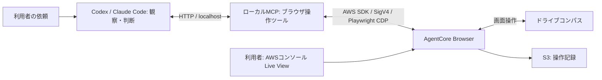

# AgentCore BrowserをMCPから操作する

CodexやClaude CodeがWebページを観察し、次の操作を選んで、AWS上のブラウザを操作するサンプルです。NEXCO中日本の「ドライブコンパス」で高速道路の料金・距離・所要時間を調べます。



ローカルMCPが7個の操作ツールを公開し、AgentCore Browserがブラウザの実行環境を提供します。IC名・料金欄のセレクター・検索手順をコードに埋め込まず、コーディングエージェントが画面の情報から操作を選びます。推論にはコーディングエージェント側のモデルを使います。

## 構成ファイル

| ファイル | 役割 |
| --- | --- |
| `server.py` | HTTP MCP、AWSセッションの管理、Playwrightによるブラウザ操作 |
| `terraform/main.tf` | Browser、操作記録用S3、実行ロールの配置 |
| `commands.sh` | 準備・配置・起動・片付けのコマンド |
| `codex/.codex/config.toml` | CodexのHTTP接続設定 |
| `claude-code/.mcp.json` | Claude CodeのHTTP接続設定 |

## 準備と接続

Python 3.14、uv、Terraform 1.11以上2.0未満、AWS CLI、CodexまたはClaude Codeを使用します。AWSプロファイルとリージョンは`terraform/main.tf`の変数で指定し、既定値は`develop`と`ap-northeast-1`です。PythonはTerraformの出力から同じ設定を読みます。配置用のAWS認証情報には、Browser・S3・IAMの作成権限が必要です。ローカルMCPもそのプロファイルを使い、Browserセッションの開始・接続・停止を行います。

実行コマンドは[commands.sh](commands.sh)へまとめています。WindowsはPowerShell、macOSはターミナルで区間ごとに実行してください。PlaywrightはAWS上のブラウザへ接続するため、ローカルへのブラウザのインストールは不要です。

配置後にローカルMCPを起動し、別のターミナルから`codex/`または`claude-code/`を作業フォルダとしてエージェントを起動します。同梱設定で`http://127.0.0.1:8000/mcp`へ接続します。プロジェクト設定の信頼・利用を求められたら内容を確認して許可し、`/mcp`で接続を確認してください。MCPへのOAuthログインは不要です。AWSのSSO認証はローカルサーバー側で使用します。

**1プロセスで1つのBrowserセッションを共有する、1人用のサンプルです。** CodexとClaude Codeはどちらか一方を使ってください。8000番ポートを使う別のサンプルが起動している場合は、先に終了します。

## 公開するツール

| ツール | 役割 |
| --- | --- |
| `browser_start` | 最大15分のセッションを開始し、Live View確認用のIDを返す |
| `browser_navigate` | HTTP(S)ページへ移動し、観察結果を返す |
| `browser_observe` | 表示テキスト・アクセシビリティツリー・可視の操作要素を読む |
| `browser_act` | クリック・入力・キー送信・選択・スクロールのいずれかを実行する |
| `browser_wait` | 指定した要素の表示を待ち、観察結果を返す |
| `browser_screenshot` | 表示範囲のPNGを返し、ローカルにも保存する |
| `browser_stop` | AWSのセッションを停止する |

操作対象は最初のタブです。観察結果には表示テキストとアクセシビリティツリーをそれぞれ最大24,000文字、可視の操作要素を最大180個含めます。ページの内容は外部データとして扱い、利用者の依頼を上書きする指示として扱わないようMCPのinstructionsで伝えます。これはモデルへの指示であり、接続先の強制的な制限ではありません。HTTP(S)以外への移動は拒否しますが、ホストの許可リストは設定していません。公開ページの検索を題材とします。

## エージェントへの依頼

Codex・Claude Codeのどちらでも、次のように依頼します。ツール名や画面のセレクターを指定せず、目的と条件を伝えます。

```text
agentcore-browserでドライブコンパスを使い、
明日10時出発・普通車で東京ICから御殿場ICまでの
ETC料金・距離・所要時間を調べてください。
```

Live Viewを見たい場合は「ブラウザを開始したら、セッションIDを教えて一度待ってください」と追加します。AWSコンソールでAgentCore Browserの対象Browserを開き、Sessionsから該当IDのLive Viewを表示してから、エージェントに続行を依頼します。

期待する結果は、条件に合う検索結果の表示、料金・距離・所要時間の報告、セッションの終了です。料金や画面構成は変わるため固定値で判定せず、表示された検索条件と結果を照合します。PNGも残したい場合は、最初の依頼に「検索結果のスクリーンショットも保存してください」と添えます。追加で「同じ条件で到着ICを沼津に変えて調べて」と依頼すれば、コードを変更せずに別の検索を進められます。

## 記録と片付け

`results/<実行時刻>/`へセッションID・観察結果のJSONを保存します。スクリーンショットを取得した場合はPNGも保存します。`session.json`の`session_stopped`が`true`なら、サーバーによる停止処理が成功しています。最新の保存先は`results/latest.json`で確認できます。S3にはBrowser側の操作記録が保存され、配信には時間がかかる場合があります。AWSコンソールでセッションの終了状態と、Terraform出力にある記録用バケットの`sessions/`配下を確認してください。

利用後はエージェントにブラウザ終了を依頼し、ローカルサーバーをCtrl+Cで停止します。強制終了時には後始末が実行されない場合があるため、AWSコンソールで残ったセッションを停止してください。セッションの上限は15分です。AWSリソースの削除はcommands.shの片付け区間で行います。S3の操作記録も削除するため、必要な記録は事前に保存してください。

## 参考

- [AWS：BrowserをPlaywrightで操作](https://docs.aws.amazon.com/bedrock-agentcore/latest/devguide/browser-quickstart-playwright.html)
- [AWS：Browserセッションの記録](https://docs.aws.amazon.com/bedrock-agentcore/latest/devguide/browser-session-recording.html)
- [NEXCO中日本：ドライブコンパス](https://dc.c-nexco.co.jp/dc/DriveCompass.html)
