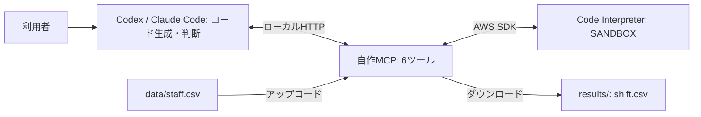

# AgentCore Code Interpreterで生成コードを隔離実行する

スタッフ6人の希望休から、1週間のシフト表を作るサンプルです。Codex／Claude CodeがPythonコードを生成し、AWS上のCode Interpreterで実行します。外部通信を閉じた環境でも、導入済みの最適化ライブラリを使って計算できます。



MCPとAWS SDKは手元で動き、生成コードはAWS側で実行します。Terraformの管理対象はカスタムCode Interpreterの1リソースです。ネットワークは`SANDBOX`で、実行ロールを付けず、ローカルのAWS認証情報もサンドボックスに渡しません。AWS APIを呼び出す認証情報と、生成コードに与える権限を分ける構成です。

隔離は計算結果の正しさを保証しません。ダウンロードしたシフト表を、生成コードとは独立した検算プログラムで確認します。入力したデータは生成コードから読み取れ、実行結果として呼び出し側に返せるため、出力内容の検査まで自動で行う仕組みではありません。

## 構成ファイル

| ファイル | 役割 |
| --- | --- |
| `terraform/main.tf` | SANDBOXモードのCode Interpreter |
| `server.py` | セッション管理、コード実行、ファイル転送を提供するHTTP MCP |
| `data/staff.csv` | 架空のスタッフと希望休 |
| `scripts/verify.py` | ダウンロードしたCSVの制約違反を検査 |
| `commands.sh` | デプロイ・起動・検算・後片付けのコマンド |
| `codex/.codex/config.toml` | Codexの接続設定 |
| `claude-code/.mcp.json` | Claude Codeの接続設定 |

## 準備と起動

Python 3.14、uv、Terraform 1.11以上2.0未満、AWS CLI、CodexまたはClaude Codeを使用します。Python 3.14はローカルMCPの実行環境であり、Code Interpreter内のPythonとは別です。

プロファイルとリージョンの既定値は`terraform/main.tf`の`develop`と`ap-northeast-1`です。サーバーはTerraform出力から設定を読み取ります。デプロイに使う権限に加え、サーバーのAWS認証情報には`bedrock-agentcore:StartCodeInterpreterSession`・`InvokeCodeInterpreter`・`StopCodeInterpreterSession`が必要です。

実行コマンドは[commands.sh](commands.sh)にまとめています。WindowsではPowerShell、macOSではターミナルでセクションごとに実行してください。デプロイ後にサーバーを起動し、別ターミナルで`codex/`または`claude-code/`からエージェントを起動します。プロジェクト設定の信頼を求められたら内容を確認し、`/mcp`で`agentcore-code-interpreter`への接続と6つのツールを確認します。ローカルMCPへのOAuthログインは不要です。

1プロセスで1セッションを共有する、1人用の構成です。エージェントはどちらか一方を使ってください。8000番ポートが使用中なら先に他のサーバーを停止します。`server.py`の`--port`で変更する場合は、接続設定のURLも揃えます。

## 公開するツール

以下はサンプルで定義した自作MCPツールです。シフト作成の制約やソルバーはツールに埋め込まず、エージェントがコードを組み立てます。

| ツール | 役割 |
| --- | --- |
| `code_start` | 15分のセッションを開始 |
| `code_upload` | `data/`直下の入力ファイルを転送 |
| `code_run` | Pythonを実行し、標準出力・標準エラー・終了コードを返す |
| `code_shell` | サンドボックス内でシェルコマンドを実行 |
| `code_download` | 成果物をローカルの`results/<実行時刻>/files/`に保存 |
| `code_stop` | セッションを終了 |

転送時のファイル名にディレクトリは指定できません。アップロード元は`data/`、ダウンロード先は結果フォルダ内に限定します。この制限はローカルのファイル転送のためのもので、AWS側で実行するコードの内容を制限するものではありません。

## シフト表を依頼する

```text
agentcore-code-interpreterでstaff.csvの希望休を守る1週間のシフト表を作ってください。
早番・遅番とも各2人、1人1日1シフト・週5日まで、遅番の翌日に早番は入れません。
勤務日数の差をなるべく小さくし、day,shift,nameの3列のshift.csvとして保存してください。
```

曜日は`月`〜`日`、シフト名は`早番`・`遅番`、氏名は入力CSVと同じ表記にします。成果物のダウンロードと利用後の終了はMCPのinstructionsで案内します。ダウンロードされていなければ、エージェントに保存先を確認してください。

| 制約 | 確認内容 |
| --- | --- |
| 各枠の人数 | 毎日、早番・遅番とも異なる2人 |
| 希望休 | `days_off`にある曜日を割り当てない |
| 1日1シフト | 同日に早番と遅番を兼ねない |
| 週の上限 | 1人5日まで |
| 遅番の翌日 | 翌日の早番に入れない（今回の週内で確認） |
| 公平性の目標 | 勤務日数の最大と最小の差を最小化 |

ダウンロード後、commands.shの検算セクションを実行します。`verify.py`は生成コードを実行せず、最新の`shift.csv`を読み込み、形式と5種類の勤務制約を検査します。勤務日数とその差も表示しますが、最適解であることまでは証明しません。結果はCSVと同じフォルダの`verification.json`に保存します。

作り直しも試す場合は、最初の依頼に「追加の変更を依頼するのでセッションを開いたままにしてください」と添え、実際に出勤している人と曜日を指定します。追加した希望休は検算にも`--off 氏名:曜日`で渡します。最後にセッション終了を依頼してください。

## 通信と認証情報の境界を確認する

同じセッションで確認する場合は、最初の依頼でセッションを開いたままにしておきます。次の依頼は動作確認用です。

```text
agentcore-code-interpreterのサンドボックスで、外部Webサイトへ接続できるか、
PyPIから追加パッケージを取得できるか、AWSの認証情報が与えられているかを確認してください。
入力データや認証情報の値を外部送信・表示せず、確認後はセッションを終了してください。
```

| 確認項目 | この構成での期待 |
| --- | --- |
| 導入済みライブラリを使う計算 | 成功する |
| 外部Webサイトへの接続 | SANDBOXの通信制限で失敗する |
| PyPIからの新規パッケージ取得 | 外部取得できない |
| AWS認証情報 | 実行ロールやローカル認証情報を与えていない |

外部通信の失敗と、認証情報がないための失敗は分けて確認します。パッケージ取得失敗の文言だけでは通信制限を証明できないため、接続先や名前解決・接続エラーも確認してください。結果は実行記録に照らして判断します。

## 記録と後片付け

`results/<実行時刻>/`にセッションID、実行したコード・コマンド（`NNN-run.txt`／`NNN-shell.txt`）、応答JSONを保存します。成果物は`files/`に保存します。標準出力・標準エラーは各20,000文字で打ち切るため、大きな結果はファイルに書き出してダウンロードしてください。

セッションの上限は15分です。通常のサーバー終了でも終了処理を行いますが、強制終了時はAWSコンソールで残存を確認して停止してください。commands.shの削除セクションでCode Interpreterを削除します。ローカルの入力・成果物は残ります。

## 参考

- [AWS：Code Interpreter](https://docs.aws.amazon.com/bedrock-agentcore/latest/devguide/code-interpreter-tool.html)
- [AWS：導入済みライブラリ](https://docs.aws.amazon.com/bedrock-agentcore/latest/devguide/code-interpreter-preinstalled-libraries.html)
- [AWS：InvokeCodeInterpreter](https://docs.aws.amazon.com/bedrock-agentcore/latest/APIReference/API_InvokeCodeInterpreter.html)
