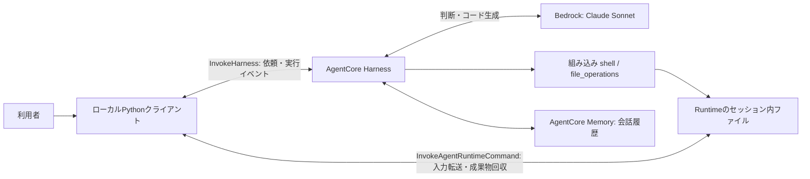

# AgentCore Harnessで経費レポートを作る

架空の経費CSVを渡し、グラフと所見を含むHTMLレポートの作成を依頼するサンプルです。AWS上のモデルがCSVを調べ、Pythonコードを書いて実行し、成果物を確認します。同じセッションで追加依頼すると、既存のコードとレポートを更新します。

ローカルクライアントは入力転送、依頼、イベント表示、成果物回収を担当します。モデルとツールを交互に呼び出す実行ループはHarnessが管理します。生成コードはHarnessのRuntime環境で実行されます。MCPへの接続やコーディングエージェントの起動は不要です。

## 構成ファイル

| ファイル | 役割 |
| --- | --- |
| `terraform/main.tf` | Harness、会話用Memory、実行ロールとIAMポリシー |
| `system_prompt.txt` | 作業場所、出力形式、検査方針の指定 |
| `scripts/client.py` | セッション管理、入出力転送、依頼と実行記録 |
| `scripts/verify.py` | CSVの独立集計と成果物の検算 |
| `data/expenses.csv` | 架空の経費26件（3か月分、税込み整数円） |
| `commands.sh` | デプロイ、作成、追加依頼、検算、停止、削除の手順 |

完成済みの分析コードやHTMLテンプレートは同梱していません。`analysis.py`・`report.html`・`metrics.json`はエージェントが作成します。検算プログラムはレポートを生成せず、入力CSVから計算した値と照合します。

## 準備と実行

Python 3.14、uv、Terraform 1.11以上2.0未満、AWS CLIを使用します。Pythonの指定はローカルクライアント用で、リモート環境のPythonとは別です。AWSプロファイルは`develop`、リージョンは`ap-northeast-1`、モデルは`jp.anthropic.claude-sonnet-4-6`を既定値としています。変更する場合は`terraform/main.tf`の変数または`terraform/terraform.tfvars`で指定します。

デプロイ用の権限に加え、クライアントには`bedrock-agentcore:GetHarness`・`InvokeHarness`・`InvokeAgentRuntimeCommand`・`StopRuntimeSession`が必要です。選択したBedrockモデルの利用条件とアクセス権限も確認してください。

実行コマンドは[commands.sh](commands.sh)にまとめています。WindowsではPowerShell、macOSではターミナルで、サンプル直下からセクションごとに実行します。後続のコマンドは`--session latest`で最後に開始したセッションを選び、対象のUUIDを表示します。過去のセッションを操作するときは`latest`の代わりに`start`が表示したUUIDを指定してください。停止・期限切れの場合も別のセッションに自動で切り替えません。

初回の依頼は次の内容です。`start`の`--prompt`で変更できます。

> この3か月分の経費CSVから、支出の傾向が分かるHTMLレポートを作ってください。グラフと、気になった点の説明も入れてください。作成したコードを実行し、集計と成果物を確認してください。

追加依頼は同じUUIDで`ask`を使います。停止済み・期限切れのセッションは再利用せず、`start`で新しいセッションを開始します。作業ファイルの保持とMemoryの会話履歴は別であり、履歴が残っていても期限切れのファイルは復元されません。1人で順番に実行する構成です。

## 確認する結果

ターミナルにはモデルの応答、`[tool]`、ツール入力と結果の一部が表示されます。操作順序や反復回数はモデルが決めるため、毎回同一にはなりません。

| 保存先 | 内容 |
| --- | --- |
| `results/<UUID>/session.json` | セッションID、モデル、Runtime ARN、ローカルで記録した状態 |
| `results/<UUID>/input.csv` | 転送した入力のコピー |
| `results/<UUID>/<実行時刻>/events.jsonl` | 推論ブロックを除く実行イベント |
| 同ディレクトリの`answer.txt`・`execution.json` | 応答、ツール呼び出し、終了理由、使用量情報 |
| 同ディレクトリの`artifacts/` | 生成コード、HTML、集計JSON |
| 同ディレクトリの`verification.json` | 検算結果（検算コマンドの実行後） |

検算では件数・総額・月別と費目別の金額、Python構文、HTMLの基本構造と外部参照の有無を確認します。生成コードをローカルで実行することはありません。文章の妥当性・グラフの見やすさ・HTMLの安全性全般を保証する検査ではないため、内容を確認してからHTMLを開いてください。

`isolation`は元のセッションに入力があり、新しいセッションには同じファイルがないことを確認します。利用者間の認可やテナント分離を検証するものではありません。

## 実行環境と制限

Harnessに許可する組み込みツールは`shell`と`file_operations`です。反復回数は25回、実行全体のトークン上限は60,000、時間上限は600秒、モデル1応答の出力上限は16,384トークンです。Runtimeはアイドル15分、最大1時間で終了する設定です。会話イベントはMemoryに7日間保存します。

ネットワークは`PUBLIC`です。生成コードが動く環境にはHarnessの実行ロールが関連付けられるため、モデル・Memoryなどへの必要な権限に限定しています。システムプロンプトの「外部リソースを使わない」というHTML作成方針は、ネットワーク通信を遮断する設定ではありません。入力には同梱の架空データを使用します。

CSV転送と成果物回収の`InvokeAgentRuntimeCommand`はモデルを通らない直接操作です。`allowed_tools`とは別にIAMで制御します。回収時にはファイル名・サイズ・ハッシュを検査し、生成されたPythonコードは保存するだけにします。

異常終了時は自動再試行しません。記録と終了理由を確認し、成果物だけ回収するなら`fetch`を使います。追加依頼や再作成にはモデルの利用料金がかかります。

## 後片付け

使用した各UUIDでセッションを停止してから、`commands.sh`末尾の削除手順を実行します。TerraformはHarness・Memory・実行ロール・IAMポリシーを削除します。Harness内部のRuntimeはサービス側で管理されます。サービスが自動作成したCloudWatchログが残る場合は、`session.json`のRuntime ARNと照合して対象ロググループを確認し、不要ならコンソールで削除してください。ローカルの`results/`は残ります。

## 参考

- [AWS：HarnessとRuntimeの比較](https://docs.aws.amazon.com/bedrock-agentcore/latest/devguide/harness-vs-runtime.html)
- [AWS：モデルと指示の設定](https://docs.aws.amazon.com/bedrock-agentcore/latest/devguide/harness-models.html)
- [AWS：組み込みツールと直接コマンド実行の権限](https://docs.aws.amazon.com/bedrock-agentcore/latest/devguide/harness-tools.html)
