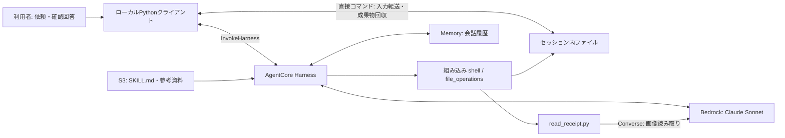
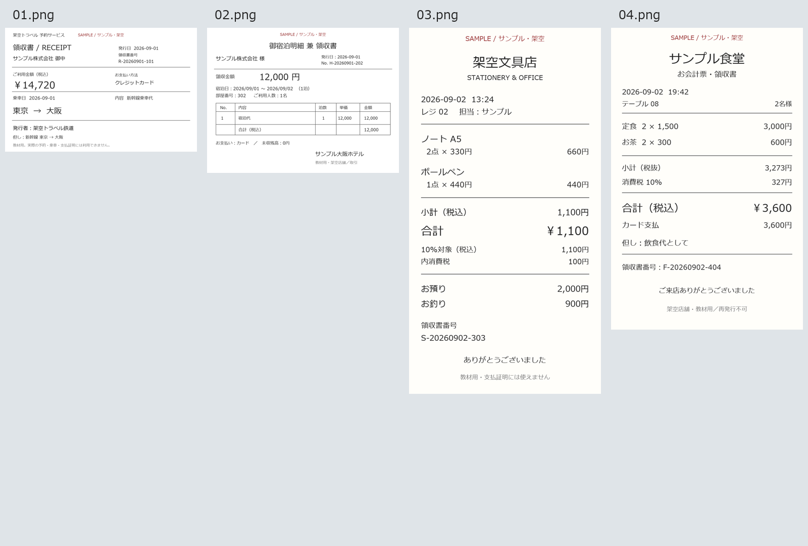

# AgentCore HarnessとSkillsで領収書を経費明細にする

架空の領収書画像5枚から、分類ルールに沿った経費明細CSVと確認事項を作るサンプルです。用途が不明な飲食代と重複候補について質問し、利用者の回答後に同じ明細を更新します。

分類・確認手順・出力形式をSkillとしてS3で配布し、Harness上のエージェントが必要な資料を読みながら作業します。Skillは業務上の指示であり、IAMのように操作を強制的に拒否するアクセス制御ではありません。

Harnessへの依頼と、画像読み取りは別の推論リクエストです。クライアントがPNGと補助スクリプトを実行環境に置き、エージェントがshellから`read_receipt.py`を実行します。このスクリプトがBedrock Converseに画像を送り、文字の転記を返します。転記結果を分類し、用途や重複を確認するのがSkillを使うエージェントです。

## 構成ファイル

| ファイル | 役割 |
| --- | --- |
| `terraform/main.tf` | Harness・Memory・IAM・Skill配布用S3 |
| `skills/expense-processing/SKILL.md` | 処理手順と確認方針 |
| `skills/expense-processing/references/` | 分類ルールと出力仕様 |
| `system_prompt.txt` | 作業場所とSkill・画像読み取りの案内 |
| `scripts/client.py` | 画像転送、依頼、記録、成果物回収、停止 |
| `scripts/read_receipt.py` | リモートで使う画像読み取り補助処理 |
| `scripts/verify.py` | 初回・回答後の明細と集計の検算 |
| `data/receipts/` | 同梱の架空PNG画像5枚 |
| `data/expected.json` | ローカル検算専用の期待値 |
| `commands.sh` | デプロイから確認回答・停止・削除までのコマンド |

Terraformの管理対象はHarness・Memory・実行ロール・IAMポリシー・S3バケット・公開アクセスブロック・Markdownオブジェクト3件の計9リソースです。S3にはSkillのMarkdownだけを置き、実行ロールの読み取り権限をそのプレフィックスに限定します。

## 領収書と期待する結果

| 画像 | 内容 | 金額 | 初回の期待 |
| --- | --- | ---: | --- |
| `01.png` | 東京→大阪の新幹線 | 14,720円 | 旅費交通費・確定 |
| `02.png` | ホテル1泊 | 12,000円 | 宿泊費・確定 |
| `03.png` | ノート・ペン | 1,100円 | 消耗品費・確定 |
| `04.png` | 用途未記入の飲食代 | 3,600円 | 用途を確認 |
| `05.png` | `01.png`の同一コピー | 14,720円 | 重複を確認 |

同梱画像は独自に描画した架空データです。レイアウトの参考元は[SOURCES.md](SOURCES.md)にまとめています。

初回は確定3件・27,820円、確認待ち2件を期待します。飲食代が取引先との打ち合わせ、コピーが重複と回答した後は、確定4件・31,420円、重複除外1件、未解決の質問0件になります。初回は`01.png`と`05.png`のどちらを原本にしても、片方だけ計上していれば検算で許容します。回答後は`01.png`だけを計上します。

画像ごとに1行を残し、`confirmed`だけを集計します。用途不足は`needs_confirmation`、重複候補は`duplicate_pending`、確認済みの重複は`duplicate`です。元画像と明細の対応を保ったまま状態を変える例であり、正式な複式簿記や税務判定は扱いません。

## 準備と実行

Python 3.14、uv、Terraform 1.11以上2.0未満、AWS CLIを使います。Pythonの指定はローカル用で、Harnessの実行環境とは別です。モデルは画像入力に対応した`jp.anthropic.claude-sonnet-4-6`、AWSプロファイルは`develop`、リージョンは`ap-northeast-1`を既定値としています。設定は`terraform/main.tf`の変数に集約し、`terraform/terraform.tfvars`でも変更できます。モデルを変更する場合はConverseの画像入力への対応も確認してください。

デプロイ用の権限に加え、クライアントには`bedrock-agentcore:GetHarness`・`InvokeHarness`・`InvokeAgentRuntimeCommand`・`StopRuntimeSession`の権限が必要です。Bedrockモデルの利用条件とアクセス権限も確認してください。

コマンドは[commands.sh](commands.sh)にまとめています。WindowsではPowerShell、macOSではターミナルで、サンプル直下からセクションごとに実行します。MCP登録やコーディングエージェントの起動は不要です。

`start`の既定の依頼は「この出張分の領収書をまとめて、経費明細CSVと確認事項を作ってください。」です。質問と暫定成果物を確認して初回の検算を行い、同じセッションに確認回答を送ります。`--session latest`は最後に開始したセッションを選び、UUIDを表示します。過去のセッションを指定するときはUUIDに置き換えます。

検算は同梱の5枚と手順に記した回答を前提とします。別の画像や別の回答を使った場合は期待値も見直してください。`data/expected.json`はAWSに送信せず、画像と読み取りスクリプトだけを転送します。

## 結果の確認

出力は`results/<UUID>/<実行時刻>/artifacts/`に保存します。

| 成果物 | 確認内容 |
| --- | --- |
| `expenses.csv` | 画像と1対1の明細、分類、状態、重複先、根拠 |
| `questions.json` | 未解決の質問。回答後は空配列 |
| `summary.json` | 状態別件数と確定分の計上額 |
| `notes.md` | 分類と確認回答の根拠 |

同じ実行ディレクトリの`events.jsonl`・`answer.txt`・`execution.json`に途中経過と応答を記録します。Skillや参考資料の利用は、回答文の自己申告だけでなく、実際の読み取りのツール呼び出しで確認してください。

`scripts/verify.py`は領収書番号・日付・発行者・金額・分類・状態・合計を照合し、通過すると`verification.json`に保存します。生成されたコードはローカルで実行しません。検算が失敗した場合は`start`を繰り返さず、該当画像、転記、明細、確認回答を照合します。画像読み取りには誤読があり得ます。

## 実装上のポイント

Skillはセッションの初回呼び出しで取得され、同一セッション内で再利用されます。Skillを変更して再デプロイした場合は、新しいセッションで確認します（詳細は[AWSのSkills仕様](https://docs.aws.amazon.com/bedrock-agentcore/latest/devguide/harness-skills.html)を参照）。

画像は20,000バイトずつ分割して転送し、ハッシュで転送結果を照合します。画像読み取りではモデルID・画像ハッシュ・指示のバージョンをキーにセッション内に転記結果をキャッシュします。同一バイトの画像を再度推論する揺れを減らしますが、別撮影の画像は同一扱いせず、誤読した結果もキャッシュされる点には注意が必要です。

画像読み取り用モデルとリージョンはTerraformから環境変数で渡します。画像読み取りにもモデル料金がかかり、その使用量はHarnessの実行ループのトークン上限とは別に扱います。

ネットワークはPUBLICです。Skillの指示だけで外部通信やAWS操作が強制的に制限されるわけではありません。実行ロールの権限と投入するデータを必要範囲に絞ります。

追加回答は同じセッションが有効な間に送ります。アイドル15分・最大1時間の実行環境と、Memoryの会話保持7日は別です。一時作業ファイルはMemoryから復元されません。異常終了時は自動再試行せず、成果物だけ回収する場合は`fetch`を使います。

## 後片付け

使用したセッションを停止してから、`commands.sh`末尾のTerraform削除手順を実行します。Skill用S3バケット内のオブジェクトも削除されるため、ほかのデータを入れないでください。自動作成されたRuntime専用CloudWatchログが残る場合は、`session.json`のRuntime ARNと照合して不要なロググループを削除します。ローカルの実行結果は残ります。
