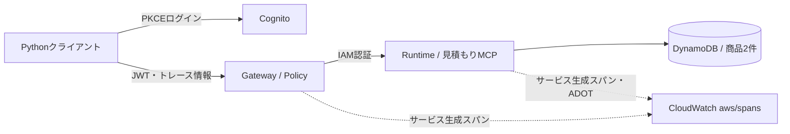

# AgentCore Runtime内部の処理をトレースする

商品見積もりのMCPを呼び、Gatewayの認可からRuntime内部のDB取得・商品確認・金額計算まで追うサンプルです。LLMは使いません。実行コマンドは[commands.sh](commands.sh)にまとめています。

## 構成



Runtimeが`calculate_quote(product_id, quantity)`を公開します。商品はP001（ノート300円）とP002（ペン150円）です。Cedarのpermitで呼び出しを許可し、forbidで数量100超を拒否します。Policy EngineはENFORCEで動作します。

| 入力 | 期待する結果 | 観察する流れ |
| --- | --- | --- |
| P001、2個 | SUCCESS、600円 | ALLOW → DB取得 → 商品確認 → 計算 |
| P001、101個 | JSON-RPCエラー -32002 | DENY、Runtimeに進まない |
| P999、2個 | NOT_FOUND | ALLOW → DB取得 → 商品確認で終了 |

`NOT_FOUND`は想定内の業務上の結果です。DB例外を握りつぶして商品なしへ変換せず、業務結果は`quote.outcome`、技術的な失敗はスパンのエラーとして区別します。数量1未満はツールの入力検証で拒否します。

## 前提と実行

Python 3.14、uv、Terraform 1.12以上2未満、AWS CLIを使用します。設定の既定値は`terraform/variables.tf`の`develop`プロファイル・東京リージョンです。必要なら`terraform.tfvars.example`を参考に`terraform/terraform.tfvars`を作成します。同じアカウントに複数配置する場合は、IAMロール名などが重ならないよう`name`を変えてください。

対象アカウント・リージョンでCloudWatchのApplication Signals（APM）→ Transaction searchを開き、スパンを構造化ログとして取り込む設定を有効にしてください。既に有効なら既存設定を使います。これはアカウント共通の事前設定で、サンプルのTerraformでは変更しません。[AWSの設定手順](https://docs.aws.amazon.com/bedrock-agentcore/latest/devguide/observability-configure.html)

commands.shはサンプル直下で実行します。WindowsはGit Bashで、uvとTerraformがPATHにあることを確認してください。Pythonクライアントは認証時にブラウザを開きます。**reader**として、ユーザー作成時に設定したパスワードでログインします。アクセストークンはプロセス内で保持し、ファイルや標準出力には保存しません。

再実行時は登録済みreaderをスキップし、3ケースを新たに呼びます。観測だけやり直したい場合は、commands.sh内のobserveコマンドだけを実行してください。Gateway Target作成が認可エラーになった場合は、少し時間を置いて再実行してください。

## 計測の仕組み

| 計測する区間 | 方法 |
| --- | --- |
| Gateway・Policy・Runtimeの呼び出し受付 | AWSのサービス生成トレース配信 |
| RuntimeのHTTP受信と親コンテキストの取得 | OpenTelemetry ASGI middleware |
| DynamoDB.GetItem | botocore自動計測 |
| 見積もりツール全体 | 手動スパン`quote.calculate_quote` |
| 商品の存在確認 | `quote.check_product`、属性`quote.lookup_outcome` |
| 金額計算 | `quote.compute_total`、属性`quote.total` |

`app/bootstrap.py`がADOTを初期化してからアプリを読み込みます。MCPはPython SDKのFastMCPを使い、計測依存をロックします。任意のPython関数すべてが自動計測されるわけではありません。業務上の区間はアプリで明示的にスパンを作ります。

GatewayとRuntimeの両方にTRACES配信を設定します。アプリの計測だけではGatewayからの親子関係をつなぐサービス側の区間が欠けるためです。`UNIFIED_TRACES_DESTINATION_ENABLED=false`で共有`aws/spans`へ揃えます。標準出力のRuntimeログとは別です。追加のメトリクス・OTelログのエクスポートは無効にし、トレースに絞っています。

Runtimeは商品テーブルのGetItemだけを許可し、X-Rayへの送信には実行ロールを使います。Gateway以外からのRuntime呼び出しはリソースポリシーで拒否します。permitとforbidを併用するためPolicy作成の静的分析は`IGNORE_ALL_FINDINGS`としますが、実行時のENFORCEを無効にする設定ではありません。

## 結果とトレースの確認

`scripts/client.py`は各ケースを1回呼び、UTC時刻・trace ID・HTTPステータス・応答を`results/latest-calls.json`へ保存します。ケースごとにX-RayとW3Cのトレースヘッダーを付け、相関と親子関係を追えるようにします。トレース情報は認証・認可には使いません。

`scripts/observe.py`は保存済みtrace IDでLogs Insightsを検索し、Policy判定・適用ポリシー・Runtimeの結果・DB取得・計算の有無を照合します。trace IDの一致に加え、`parentSpanId`と`spanId`をたどってGatewayから内部処理へつながるかも確認します。原文と照合結果は`results/latest-spans.json`へ保存します。

既定の300秒以内に必要な記録が揃わなければ`incomplete_observation`、終了コード2になります。拒否ケースのログがないことだけで未実行と断定せず、Policyの拒否応答・ENFORCE・正常ケースの計測成功も併せて見ます。件数・時刻・所要時間は実行ごとに変わります。

CloudWatchのLogs Insightsで`aws/spans`と実行時刻を選び、trace IDで検索します。

```sql
fields jsonParse(@message) as s
| fields @timestamp, name, spanId, parentSpanId,
    durationNano / 1000000 as duration_ms,
    s.attributes.`aws.agentcore.policy.authorization_decision` as decision,
    s.attributes.`quote.outcome` as outcome,
    s.attributes.`quote.lookup_outcome` as product_lookup,
    s.attributes.`quote.total` as total,
    status.code
| filter traceId = "<latest-calls.jsonのtrace_id>"
| sort startTimeUnixNano asc
| limit 100
```

親の所要時間には子の処理時間が含まれるため、全スパンの時間を足し合わせません。MCPの初期化なども記録されるため、スパン件数はツールの実行回数と一致しません。商品なしの場合は`NOT_FOUND`と計算スパンなし、Policy拒否の場合はDENYを確認します。

## ファイルと片付け

- `app/`: MCPツールとADOT初期化。
- `terraform/`: Runtime、Gateway、Cognito、Policy、商品テーブル、トレース配信。
- `scripts/`: ビルド、ユーザー作成、認証、3ケースの実行、トレース照合、片付け。
- `results/`: 実行記録。Git管理対象外。

片付けはcommands.sh末尾のコメントアウトした手順で行います。Terraform削除前に対象のIDを保存し、削除後に専用RuntimeログとRuntime・GatewayのWorkload Identityを片付けます。共有のTransaction Search・`aws/spans`・トレース配信用の共有ポリシーは残ります。保存済みスパンは共有ログの保持設定に従います。ログ保存・クエリ等の料金が発生します。

## 参考資料

- [AgentCoreの可観測性設定](https://docs.aws.amazon.com/bedrock-agentcore/latest/devguide/observability-configure.html)
- [Policyの観測データ](https://docs.aws.amazon.com/bedrock-agentcore/latest/devguide/observability-policy-metrics.html)
- [OpenTelemetryのbotocore計測](https://opentelemetry-python-contrib.readthedocs.io/en/latest/instrumentation/botocore/botocore.html)
