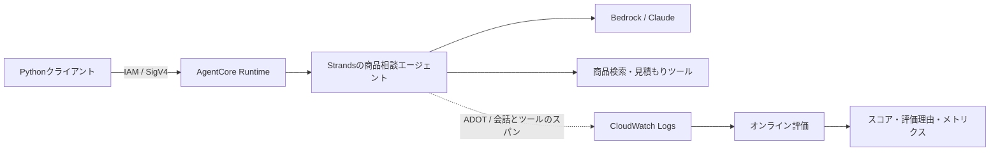

# AgentCore Evaluationsで会話の品質を継続評価する

文具の見積もりを行うエージェントを通常どおり呼び出し、会話・ツール実行のトレースをオンライン評価します。応答を待つ経路に評価処理を挟まず、後から評価スコアと理由を確認します。

## 比較するもの

同じモデル・指示文・ツールを使い、会話履歴の扱いだけを変えます。

| 実装 | 会話履歴 | 追加依頼で確認する点 |
| --- | --- | --- |
| `forgetful` | 各リクエストでAgentを作り直す（意図的な不具合） | ノートの購入や500円の予算を忘れ、追加確認や不完全な見積もりになるか |
| `fixed` | 同じRuntimeセッション内でAgentを再利用 | 既存の購入品と予算を引き継いで更新できるか |

ノートは300円、ペンは150円です。最初に1つずつ（450円）、続いてペンを2本に変更（600円、予算500円を超過）する会話と、未登録の商品P999を含めた問い合わせを送ります。2種類の実装×2ケースで計4セッション・6リクエストです。商品データはコード内の架空データで、購入・予約は行いません。

`fixed`の履歴もPythonプロセス内の一時的なものです。セッション終了後の復元や長期記憶は扱いません。再実行では新しいUUIDを発行し、以前の評価と混ぜません。

## 評価の仕組み

- **Helpfulness**: トレース単位で回答の有用性を評価します。
- **GoalSuccessRate**: セッション全体で利用者の目的を達成できたか評価します。
- サンプリング率は教材用に100%、セッションの評価用アイドル時間は1分です。Runtimeのアイドル時間（5分）とは別設定です。
- Strandsが会話・モデル・ツールのスパンを生成し、ADOTをPythonライブラリとして組み込みます。Collectorのサイドカーは不要です。
- スパンと会話内容をRuntime専用ロググループに保存します。評価設定は専用ロググループと`service.name`を指定し、評価実行ロールの読み取りも専用ログに限定します。
- `bootstrap.py`でRuntimeが渡すロググループを読み、OTLPの送信ヘッダーに設定します。X-Rayからそのロググループへの書き込みはTerraformのリソースポリシーで許可します。`AWS_GENAI_CONTENT_EXTRACTION_OPT_OUT=true`により、会話内容を別イベントに分離せずスパン内に残します。
- 評価は非同期です。1分後に必ず完了するという意味ではなく、到着までさらに時間がかかります。
- 評価スコアの差は保証しません。会話全体では条件を落としていても、単独の回答としては確認質問が有用と評価されることがあります。点数と理由、実際の会話を併せて読みます。

## 準備と実行

Python 3.14、uv、Terraform、AWS CLI、AWSの`develop`プロファイルを用意します。東京リージョンを使用します。モデルの既定値は`jp.anthropic.claude-sonnet-4-6`です。必要ならTerraformの`model_id`を変更してください。

対象アカウント・リージョンでCloudWatch Transaction Searchを有効にしておきます。既存設定があれば再設定は不要です。Terraformは共有の設定を変更しません。

実行コマンドは`commands.sh`にまとめています。WindowsはGit Bash、macOSはターミナルからサンプル直下で実行します。Cognitoやブラウザでのログインはなく、PythonからAWS認証情報でRuntimeを呼び出します。

`commands.sh`はデプロイ後に相談を実行し、オンライン評価の到着を最大15分待ちます。到着が遅れた場合は`observe.py`の行だけ再実行してください。`commands.sh`全体の再実行は新しい会話を作り、モデル呼び出し・評価も再度発生します。

## 結果の確認

- `results/calls-<日時>.json`: 会話・実装種別・ケース・RuntimeセッションID。`latest-calls.json`は直近の記録です。
- `results/evaluations-<日時>.json`: セッション別の評価とサービスの生イベント。`latest-evaluations.json`は直近の観測結果です。
- `observe.py`は保存された呼び出し記録に対応する評価を取得するだけで、モデルや評価APIを直接呼び出しません。
- PASSは必要な評価結果が到着したことを表します。「修正後の点数が必ず高い」「回答の正しさが保証された」という意味ではありません。

GUIでは東京リージョンのCloudWatchで **GenAI Observability → Bedrock AgentCore → 対象エージェント／DEFAULT → Evaluations**を開きます。評価の集計からセッション・トレースに進み、低評価の理由と元の会話・ツール呼び出しを照合します。評価結果のロググループは評価設定の詳細にも表示されます。

### 実測例

4セッション・6リクエストを実行し、Helpfulnessが6件、GoalSuccessRateが4件返りました。スコアはこの1回の実測であり、再実行時に同じ値になるとは限りません。

| ケース | 実装 | Helpfulness（ターン順） | GoalSuccessRate |
| --- | --- | --- | --- |
| 数量変更 | `forgetful` | 1.00 → 0.17 | 0（No） |
| 数量変更 | `fixed` | 1.00 → 0.83 | 1（Yes） |
| 未登録商品 | `forgetful` | 0.67 | 0（No） |
| 未登録商品 | `fixed` | 0.67 | 0（No） |

数量変更では、不具合ありの実装が既に伝えた条件を聞き直したことを評価器が指摘し、修正後は600円・予算超過まで回答できました。未登録商品の場合は両方とも価格を創作しませんでしたが、評価器は「既知のノートだけでも部分見積もりを示せたのに、確認質問で止めた」と指摘しました。**情報を創作しないことと、利用者の目的を達成することは別の観点**です。業務上は勝手に部分見積もりを出さない方がよい場合もあり、その判断を評価スコアだけに任せず、評価理由と実際の要件を照合します。

今回は会話開始から評価到着まで約11分半かかりました。無通信1分の設定でも、収集・採点・ログ配送を含む待ち時間は別にあります。

## 実装の所在

| ファイル | 役割 |
| --- | --- |
| `app/server.py` | Strandsエージェント、2つのツール、履歴保持の比較 |
| `app/bootstrap.py` | ADOTの初期化後にHTTPサーバーを起動 |
| `terraform/main.tf` | ZIPデプロイのRuntime、実行ロール、コード保存先 |
| `terraform/evaluations.tf` | 評価実行ロール、組み込み評価器、サンプリング・アイドル設定 |
| `scripts/client.py` | 同じ相談を2種類の実装で実行し、応答を保存 |
| `scripts/observe.py` | オンライン評価の到着確認と記録 |
| `scripts/logs.py` | 自動作成されるRuntimeログとの競合を避けて保持期間を設定 |
| `scripts/cleanup.py` | 削除対象の記録と自動生成リソースの削除 |

## 停止と後片付け

評価の一時停止とリソース削除も`commands.sh`末尾にあります。評価停止だけではRuntimeは残ります。削除前に対象を記録し、Terraform削除後に専用ログとWorkload Identityを削除します。共有のTransaction Search設定は残します。

モデル呼び出し、オンライン評価、Runtime、ログ保存・検索等の料金が発生します。評価に必要なため質問・回答・ツールの入力と出力がログに残ります。この例では架空の商品情報のみを扱い、実データを入れる場合はログ閲覧権限・保持期間も見直してください。

## 参考

- [オンライン評価の設定](https://docs.aws.amazon.com/bedrock-agentcore/latest/devguide/create-online-evaluations.html)
- [Strandsの計測](https://docs.aws.amazon.com/bedrock-agentcore/latest/devguide/supported-frameworks-strands.html)
- [会話内容を含むテレメトリの配送](https://docs.aws.amazon.com/bedrock-agentcore/latest/devguide/supported-frameworks-telemetry.html)
- [評価結果と保存先](https://docs.aws.amazon.com/bedrock-agentcore/latest/devguide/results-and-output.html)
- [ADOTの送信ヘッダーと専用ログへの配送ポリシー](https://docs.aws.amazon.com/AmazonCloudWatch/latest/monitoring/omni-send-ai-agent-telemetry.html)
